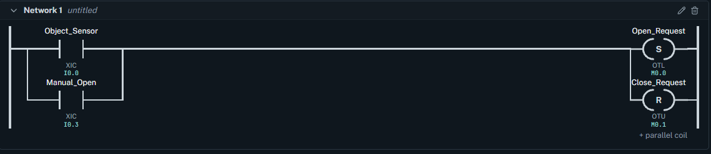
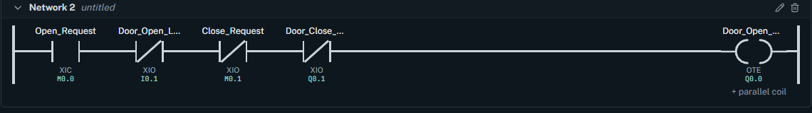
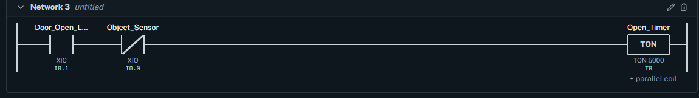
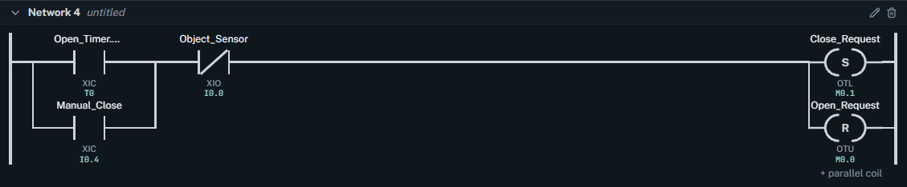
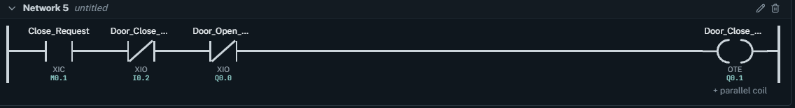
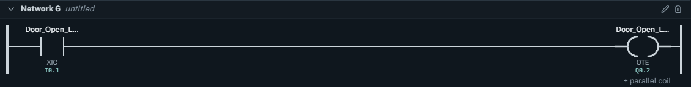
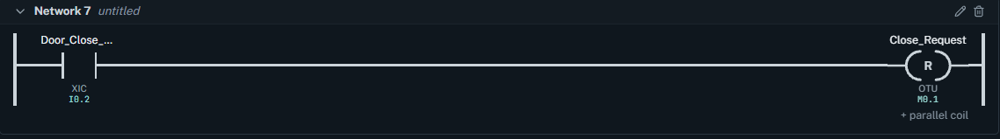

# Automatic Warehouse Door Control — PLC Ladder Logic

## Project Overview

This project demonstrates an Automatic Garage Door Control System developed using LADX PLC Ladder Logic Simulator.

The system controls a warehouse door using automatic object detection and manual open/close commands. It uses limit switches to determine the door position, a timer to control automatic closing, and interlocking logic to prevent conflicting motor commands.

## Features

- **Automatic Opening:** The door opens when an object is detected.
- **Manual Opening:** The operator can open the door using the `Manual_Open` switch.
- **Manual Closing:** The operator can request closing using the `Manual_Close` switch.
- **Automatic Closing:** The door closes after a 5-second delay when fully open and the object sensor is clear.
- **Object Detection During Closing:** An object detection cancels the closing request and initiates reopening.
- **Limit Switch Control:** Opening and closing motors stop at their respective limit positions.
- **Motor Interlocking:** Logic prevents both motor outputs from being commanded ON simultaneously.
- **Door Open Indicator:** A lamp indicates when the door is fully open.

### Network 1 — Automatic and Manual Opening Request

This network contains two normally open contacts connected in parallel:

- `Object_Sensor`
- `Manual_Open`

When either input is activated, the network performs two operations using parallel output coils:

1. **SET `Open_Request`** — Stores the opening command.
2. **RESET `Close_Request`** — Cancels an existing closing command.

This allows either automatic detection or manual operation to request opening.

If an object is detected while the door is closing, this network cancels the closing request and activates the opening request.

### Network 2 — Opening Motor Control

This network controls `Door_Open_Motor`.

The opening motor runs when all the following conditions are satisfied:

- `Open_Request = 1`
- `Door_Open_Limit = 0`
- `Close_Request = 0`
- `Door_Close_Motor = 0`

The network uses normally closed contacts for the open limit, closing request, and closing motor.

When the door reaches its fully open position, `Door_Open_Limit` becomes active and stops the opening motor.

The closing motor interlock helps prevent both motors from operating simultaneously.

### Network 3 — Automatic Closing Timer

This network uses two contacts connected in series:

- `Door_Open_Limit` — Normally Open
- `Object_Sensor` — Normally Closed

These contacts control the `Open_Timer` TON instruction.

Timer preset:5 seconds

The timer starts when the door is fully open and no object is detected.

If an object is detected while the timer is counting, the normally closed sensor contact opens, interrupting and resetting the timer.

Once the object sensor becomes clear again, the timer can restart.

After five continuous seconds with the door fully open and the sensor clear, the timer completes.

### Network 4 — Automatic and Manual Closing Request

This network provides two ways to request closing.

Automatic closing: The `Open_Timer` contact becomes active after the timer finishes.

Manual closing: The operator activates `Manual_Close`.

These two contacts are connected in parallel, followed by a normally closed `Object_Sensor` contact.

When either closing condition is active and the object sensor is clear, the network performs two operations:

1. SET `Close_Request`
2. RESET `Open_Request` 

This allows the system to transition from the opening stage to the closing stage.

### Network 5 — Closing Motor Control

This network controls `Door_Close_Motor`.

The closing motor runs when:

- `Close_Request = 1`
- `Door_Close_Limit = 0`
- `Door_Open_Motor = 0`

The closed-limit and opening-motor contacts are normally closed.

When the door reaches its fully closed position, the closed-limit contact opens and stops the closing motor.

The opening motor contact provides an interlock against simultaneous motor operation.

Object detection is handled by Network 1, which cancels `Close_Request` and sets `Open_Request`.

### Network 6 — Door Open Indicator

This network controls `Door_Open_Lamp`.

It uses a normally open `Door_Open_Limit` contact connected to a normal output coil.

When the door reaches the fully open position, the lamp turns ON.

When the door moves away from the fully open position, the lamp turns OFF.

### Network 7 — Reset Closing Request

The final network uses the normally open `Door_Close_Limit` contact to activate a RESET coil for `Close_Request`.

When the door reaches the fully closed position, `Close_Request` is reset to 0.

This completes the closing cycle and prepares the system for the next opening command.

*Part of my PLC & Industrial Automation Portfolio.*
