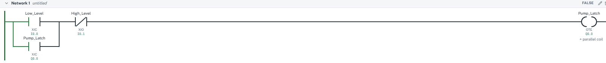
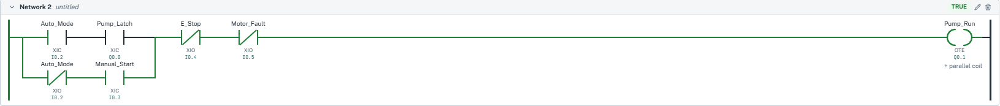
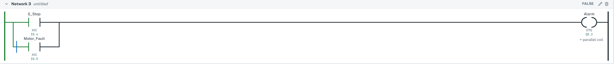
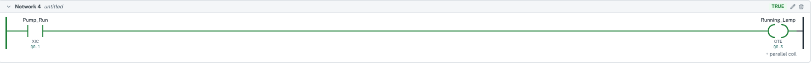

# Water Tank Pump Control — PLC Ladder Logic

##Video Demo : https://youtu.be/j1ffTtix1-k

## Overview

Simulated PLC-based water tank filling system developed using LADX Ladder Simulator.

This project demonstrates automatic and manual pump operation, pump latching, safety interlocks, and alarm handling using ladder logic.

## Features

- Automatic pump startup when the low-level sensor activates (representing 30% tank level)
- Pump latching until the high-level sensor activates (representing 80% tank level)
- Manual pump operation using a momentary start button
- Emergency-stop and motor-fault interlocks
- Fault alarm indication
- Pump running status indicator

## Ladder Logic Networks

| Network | Description |
|---|---|
| 1 | Automatic pump latch and high-level cutoff |
| 2 | Automatic/manual pump control with safety interlocks |
| 3 | Emergency-stop and motor-fault alarm |
| 4 | Pump running indicator |

## Screenshots

### Network 1 — Automatic Pump Latch

### Network 2 — Automatic/Manual Pump Control

### Network 3 — Fault Alarm

### Network 4 — Running Indicator

